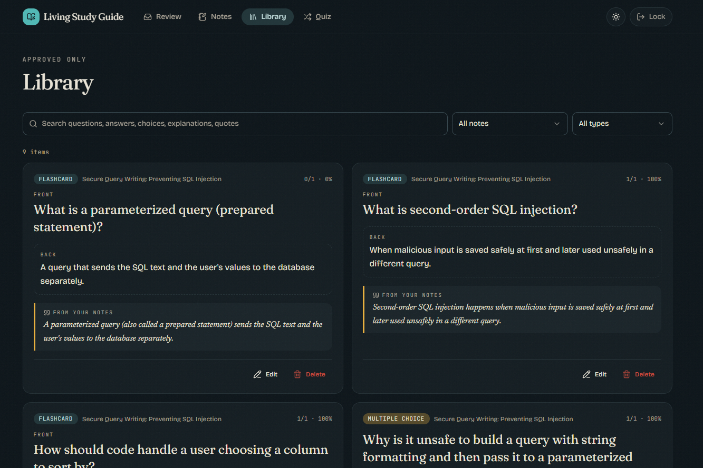

<p align="center">
  
</p>

```js
const nirmal = {
  dayJob:    "Software Developer @ ThoughtWorks",
  sideJob:   "AI Trainer & Model Evaluator @ Mercor",
  gamerTag:  "OPTiMUS",
  atWork:    ["Spring Boot", "Redis", "Kafka", "Kogito DMN"],
  forFun:    ["MongoDB", "Express", "React", "React Native", "Node.js"],
  studied:   "B.E. Information Technology, AIT Pune (2025)",
  askMeAbout: ["caching", "rule engines", "why your PDF takes a minute"],
};
```

### 🔦 Latest build: Living Study Guide

<a href="https://muddy-miserly-cloudcomputing.replit.app/"></a>

Paste in your notes and Claude turns them into flashcards, quizzes and concept pages. The catch: every card has to quote the exact sentence it came from, and nothing reaches the library until I approve it next to that sentence. Built with Python, Flask, PostgreSQL and the Claude API.

### 🛠️ Tools

<p align="center">
  
</p>

<details>
<summary><b>💼 Where I've worked</b></summary>
<br/>

**ThoughtWorks** · Software Developer · Jan 2025 – now<br/>
Redis caching to cut repeated database calls, Kogito DMN rules for insurance workflows, and hunting down slow spots in backend services.

**Mercor** · AI Trainer & Model Evaluator · Aug 2026 – now<br/>
Writing prompts and reference answers for LLM training, and grading model answers against rubrics.

**Spring Money** · Full-Stack Developer Intern · Mar 2024 – Dec 2024<br/>
A Node.js rule engine (20% faster, 90% less code), PDF generation moved to a Puppeteer backend (60 s down to 15 s), the retirement and financial X-ray calculators in Next.js, and features for HumFauji, a React Native money planner for armed forces personnel.

**At college:** Technical Head of the Technical Board at AIT Pune, and Web Development Head for Solutions23.

</details>

### 📫 Say hi

<p>
  <a href="https://www.linkedin.com/in/nirmal-nehra-637048226/"></a>
  <a href="mailto:nirmalnehra.nn@gmail.com"></a>
  
</p>


